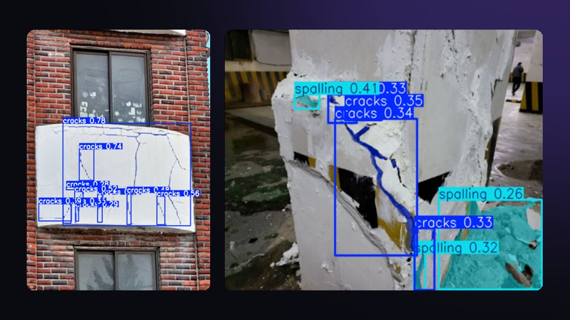
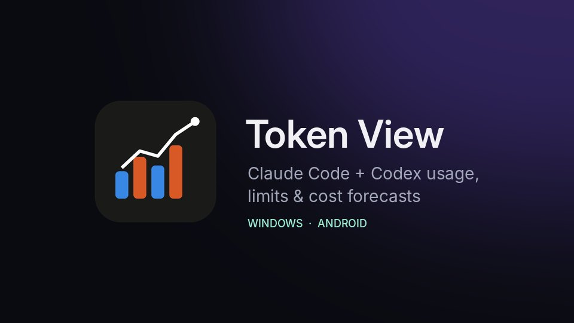

<a href="https://frotrue.github.io/frotrue/">
  <picture>
    <source media="(prefers-color-scheme: dark)" srcset="assets/header-dark.svg">
    
  </picture>
</a>

  
  
  

Software engineering student who likes taking an idea all the way to something shippable — a game on Steam, a desktop app, a phone widget. Most of what I make starts as a tool I wanted for myself.

- 🎮 **Shipped** [corectl](https://store.steampowered.com/app/4963500/corectl/), a 2D roguelite tower defense, on Steam (Aug 2026)
- 🔭 **Building** [Nightwatch Array](https://github.com/frotrue/nightwatch-array), an incremental game about a night-sky observatory
- 🧪 **Exploring** [AI2D Runtime](https://github.com/frotrue/ai2d-runtime) — can AI-authored game specs compile into deterministic, testable games?

## Featured

<table>
  <tr>
    <td width="50%" valign="top">
      
      <h3><a href="https://store.steampowered.com/app/4963500/corectl/">corectl</a></h3>
      <b>Released on Steam</b> · Phaser · TypeScript · CEF / D3D11
      
Roguelite tower defense about rerouting enemies from three entry zones, limited building loadouts, and wave-reward synergies. Designed, built, and published solo.

    </td>
    <td width="50%" valign="top">
      
      <h3><a href="https://github.com/frotrue/smart_crack_detection">Smart Crack Detection</a></h3>
       YOLOv8 · OpenCV · PyQt6
      
Segments cracks and spalling on buildings and scores the risk. The full entry paired it with Raspberry Pi / NPU hardware in a custom 3D-printed enclosure.

    </td>
  </tr>
  <tr>
    <td width="50%" valign="top">
      
      <h3><a href="https://github.com/frotrue/token-view">Token View</a></h3>
      <b>Windows + Android</b> · Tauri · TypeScript
      
Tracks Claude Code and Codex token usage, API-equivalent cost, and rate limits — and predicts when you'll run out. Syncs to your own Google Drive, no server.

    </td>
    <td width="50%" valign="top">
      
      <h3><a href="https://github.com/frotrue/LectureScribe">LectureScribe</a></h3>
      <b>Desktop app</b> · Python · faster-whisper · PyQt6
      
Drop in a lecture recording and get a local Whisper transcript (TXT / Markdown / SRT), with optional study-note summaries. CPU and GPU presets, plus a batch CLI.

    </td>
  </tr>
</table>

## More things I've made

| | Project | What it is | Stack |
|:-:|---|---|---|
| 🔭 | [**Nightwatch Array**](https://github.com/frotrue/nightwatch-array) · [play ↗](https://frotrue.github.io/nightwatch-array/) | Short incremental game — observe the sky, work through 162 research nodes, grow an observatory | Godot · GDScript |
| ⚙️ | [**AI2D Runtime**](https://github.com/frotrue/ai2d-runtime) · [arch ↗](https://github.com/frotrue/ai2d-runtime/blob/main/docs/architecture/overview.md) | JSON game specs → validated execution plans, deterministic sim, instanced rendering | C++23 · SDL3 · Vulkan |
| 🚚 | [**ETS2 Lane Guide**](https://github.com/frotrue/ets2-lane-guide) | In-game lane, turn, and traffic-signal HUD for Euro Truck Simulator 2, drawn in a DX11 plugin | C++ · DirectX 11 |
| 📊 | [**Codex Quota**](https://github.com/frotrue/codex_usage_moblie) | Android home-screen widget for Codex limits with burn-rate forecasts | Java · Android |
| 🎵 | [**YTM Lyrics Following**](https://github.com/frotrue/ytm-lyrics-following) | Synced, auto-scrolling lyrics for YouTube Music (Firefox / Chromium) | WebExtension · JS |
| 🔁 | [**DeepSeek Handoff**](https://github.com/frotrue/deepseek-handoff) | Codex skill that hands a bounded task to a local DeepSeek worker and resumes for review | Node.js |
| 🛣️ | [**Road Hazard Segmentation**](https://github.com/frotrue/yolov8_seg_CodeAndDatasets) | Cracks, potholes, and sinkholes from road imagery | YOLOv8 |
| 🏭 | [**Gradium**](https://github.com/frotrue/factor) | Factory-building tower defense prototype | Phaser · TypeScript |

## How I build

I work with AI coding assistants every day, mostly Codex. My job is to define the behavior, review what comes back, and prove it works.

- **Define the system** — requirements, constraints, and architecture decisions written down, not implied.
- **Verify the implementation** — regression tests, reproducible scenarios, real measurements.
- **Refine the experience** — playtesting and daily use drive controls, UI, and progression.

Examples: [AI2D architecture & constraints](https://github.com/frotrue/ai2d-runtime/blob/main/docs/architecture/overview.md) · [Nightwatch economy simulator](https://github.com/frotrue/nightwatch-array/blob/main/docs/economy-simulator.md)

## Stack

  
  &nbsp;
  
  &nbsp;
  

Also: YOLOv8 · Phaser · SDL3 · Vulkan · DirectX 11 · GDScript · Capacitor

## Activity

<b>GitHub, algorithms, and AI usage</b>

 

<picture>
  <source media="(prefers-color-scheme: dark)" srcset="https://github-readme-stats.vercel.app/api?username=frotrue&amp;show_icons=true&amp;theme=github_dark&amp;include_all_commits=true&amp;hide_border=true">
  
</picture>

AI coding assistant usage, tracked with [Tokscale](https://tokscale.ai/u/frotrue):

